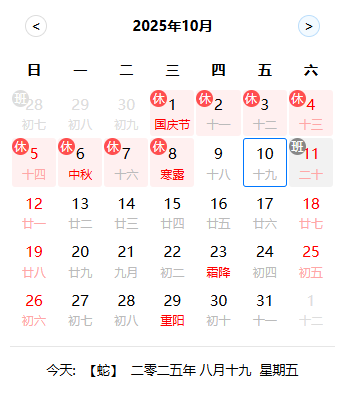

# calendar.crx

谷歌浏览器日历插件，可查看农历、节假日以及补班调休信息。

## ✨ 功能特性

- 📅 **完整日历视图** - 清晰展示当月所有日期
- 🌙 **农历信息** - 显示农历日期、生肖、节气
- 🎉 **节假日标记** - 自动标注法定节假日和调休补班
- 🔄 **月份切换** - 快速浏览不同月份
- 📍 **今日定位** - 一键回到当前日期
- 💾 **智能缓存** - 节假日数据本地缓存，减少网络请求

## 📸 效果图



## 🚀 版本 2.0 更新

版本 2.0 采用 React + TypeScript 完全重写，带来更好的性能和开发体验：

### 技术升级
- ✅ 使用 React 18 + TypeScript 重构，提升代码质量和类型安全
- ✅ 采用 UmiJS 4 构建，优化打包体积和加载速度
- ✅ 完整的类型定义，消除运行时类型错误

### 性能优化
- ⚡ 智能缓存机制，减少 90% 以上的网络请求
- ⚡ 组件级优化，防止不必要的重渲染
- ⚡ 内存泄漏修复，提升稳定性

### 代码质量
- 🛡️ 完善的错误处理，网络异常不影响基本功能
- 🎨 CSS 变量支持，便于主题定制
- 📦 模块化设计，代码结构清晰

## 📦 安装使用

### 方式一：下载预编译包

1. 下载插件包：[calendar.crx.zip](./calendar.crx.zip)
2. 打开 Chrome 浏览器，访问 `chrome://extensions`
3. 启用右上角的"开发者模式"
4. 将插件包拖入页面进行安装

### 方式二：手动编译

1. 克隆项目
   ```bash
   git clone https://github.com/gyxing/calendar.crx.git
   cd calendar.crx
   ```

2. 安装依赖
   ```bash
   yarn install
   ```

3. 编译打包
   ```bash
   npm run build
   ```

4. 加载扩展
   - 打开 Chrome 浏览器，访问 `chrome://extensions`
   - 启用"开发者模式"
   - 点击"加载已解压的扩展程序"
   - 选择 `dist/calendar.crx` 目录

## 🛠️ 开发指南

### 开发环境要求

- Node.js >= 16
- Yarn 或 npm

### 本地开发

```bash
# 安装依赖
yarn install

# 启动开发服务器
npm run start

# 类型检查
npx tsc --noEmit

# 构建生产版本
npm run build
```

### 项目结构

```
calendar.crx/
├── src/
│   ├── pages/          # 页面组件
│   │   ├── index.tsx   # 主页面
│   │   ├── header/     # 头部组件
│   │   ├── content/    # 日历内容
│   │   └── footer/     # 底部信息
│   ├── utils/          # 工具函数
│   └── global.less     # 全局样式
├── public/             # 静态资源
│   ├── images/         # 图片资源
│   └── manifest.json   # 扩展配置
└── typings.d.ts        # 类型定义
```

## 📝 技术栈

- **框架**: React 18
- **语言**: TypeScript 5
- **构建工具**: UmiJS 4
- **样式**: Less
- **农历库**: solarlunar-es
- **打包**: Webpack (via UmiJS)

## 📄 许可证

MIT License

